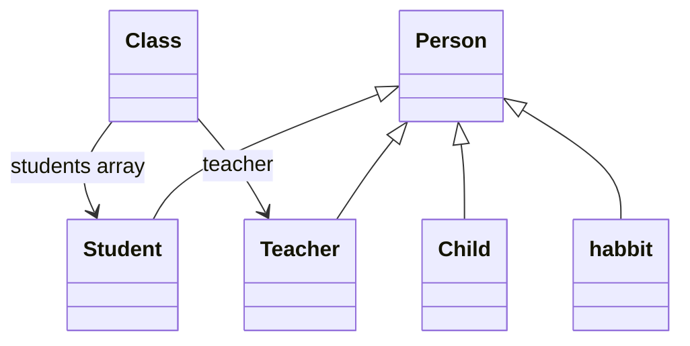

# Java OOP School Simulation

[](https://github.com/the1ZAKK/java-oop-school-simulation/actions/workflows/java.yml)

Java and Eclipse coursework by **Zakaria Brim**, reconstructed from the original final report after the source files were lost. The project models people, students, teachers and a class roster, then demonstrates their relationships through console output.

The seven original class names and the `report` package are preserved. `TEST` follows the Eclipse screenshot and its output; `ReportTextDemo` preserves the different example printed in the report. See the [reconstruction notes](docs/reconstruction.md) for the evidence and differences.

## What the project demonstrates

- **Inheritance:** `Student`, `Teacher`, `Child` and the original `habbit` class extend `Person`.
- **Encapsulation:** private fields accessed through getters and setters.
- **Object relationships:** `Class` holds a `Teacher` reference and a `Student[]` roster.
- **Console output:** an executable example connects the objects and prints their values.

This is a small educational console application. The reported design has no graphical interface, database, registration workflow or input validation.

## Run in Eclipse

Use a **JDK 17 or later**. The included Eclipse configuration targets Java 17.

1. Clone this repository or extract its source download.
2. In Eclipse, select **File > Import > General > Existing Projects into Workspace**.
3. Select the extracted `java-oop-school-simulation` folder and import **JavaOOPSchoolSimulation**.
4. Open `src/report/TEST.java` and choose **Run As > Java Application**.

If Eclipse reports an unbound JavaSE-17 library, select an installed JDK 17 or later under the project's **Java Build Path > Libraries**. `launches/SchoolDemo.launch` and `launches/ReportTextDemo.launch` are also supplied.

## Run from the command line

No external Java libraries, Maven, Gradle or network access are required once a JDK is installed. The build scripts use the compiler and JAR-tool modules included in the JDK.

Start with a local copy:

```bash
git clone https://github.com/the1ZAKK/java-oop-school-simulation.git
cd java-oop-school-simulation
```

**Windows:** double-click `run.cmd`. It compiles the source, runs the screenshot example and keeps the console open. To build or test from a terminal:

```bat
build.cmd
test.cmd
```

**Linux or macOS:**

```bash
bash run.sh
bash test.sh
```

After a build, either example can be run directly:

```bash
java -cp build/classes report.TEST
java -cp build/classes report.ReportTextDemo
java -jar build/java-oop-school-simulation.jar
```

Build output is excluded from Git. The separately prepared reconstruction ZIP includes a prebuilt `java-oop-school-simulation.jar` for the initial source version; GitHub's source ZIP contains the source and build scripts. Rebuild after editing the source.

## Screenshot example output

```text
my name is  BRIM ZAKARIA i came from Morocco to china i'm  19 i live in Dalian my student ID is 219101
teacher name is: Mr. Charles he's teaching us object oriented programming he is  29 years old Dalian his ID card is 1512
Class: PE teacher, Mr. Charles, BRIM ZAKARIA
Child: William, 10, USA, BRIM
habbit: play football also he like to listen to music  and read books
```

The original wording and spacing are retained for comparison with the report. The names and values are historical example data, not current profile information.

## Classes

| Class | Role |
| --- | --- |
| `Person` | Shared name, age and address |
| `Student` | Inherited person data and a student ID |
| `Teacher` | Inherited person data and a teacher ID |
| `Child` | Inherited person data and a parent's name |
| `Class` | A class name, teacher reference and array of students |
| `habbit` | The original habit example and its additional `habitName` field |
| `TEST` | Default demo matching the Eclipse screenshot |
| `ReportTextDemo` | Added entry point for the report's written-code variant |



`report.Class` preserves the coursework name and is distinct from `java.lang.Class`. The spelling and capitalization of `habbit` and `TEST` are intentional. In both report demos, the habit description uses inherited `name`; `habitName` remains a separate property.

## Verification

The dependency-free test runner checks both report examples, inheritance and encapsulation, shared teacher/student references, multiple and empty rosters, original null/default behavior, and the two independent habit fields. Golden output files are under `examples/`.

See [validation details](docs/validation.md) for the actual checks performed. The GitHub Actions workflow is prepared to run `test.sh` on Ubuntu and `test.cmd` on Windows with Java 17 after this source is pushed. A prepared workflow is not a claim that hosted CI has already run.

## Project history

This repository restores bachelor's object-oriented programming coursework originally written in Java using Eclipse. The original source was lost, so the implementation was reconstructed from the author's final report. [Reconstruction notes](docs/reconstruction.md) distinguish the restored classes from the build scripts, tests and IDE configuration added during recovery.
